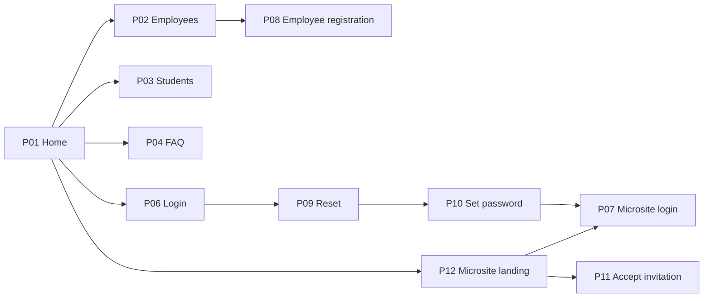
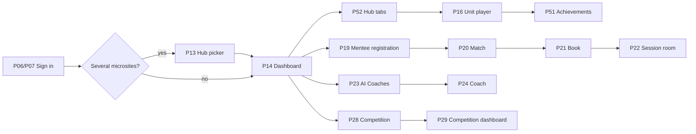
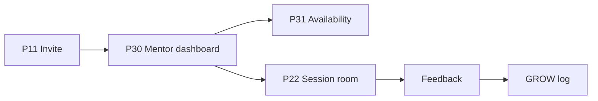
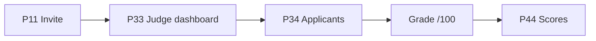
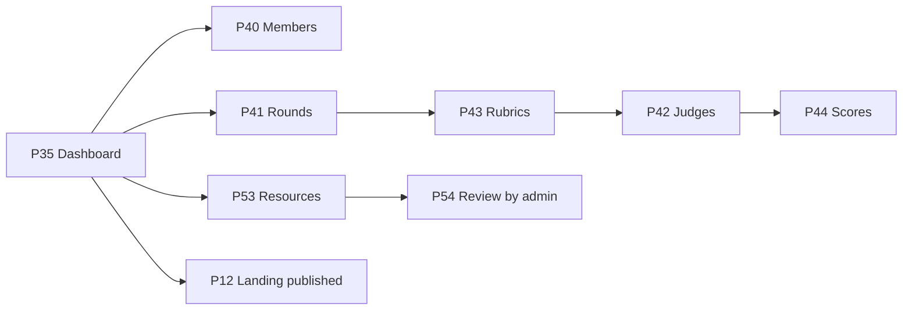
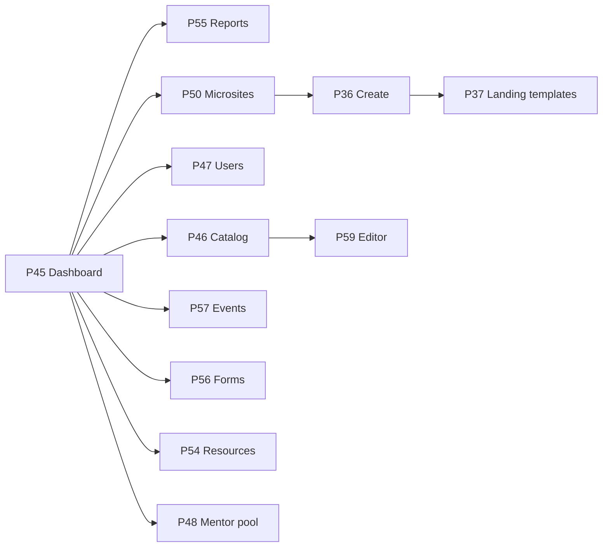

# DCT Learn — Platform Requirements Specification

**Status:** Draft v0.3 for review · **As of:** 2026-10-07 · **Author:** Aliya (with Claude Code)
**Single source of truth for** the frontend mockup and the backend build. Companion files:
[`API-CONTRACT.md`](API-CONTRACT.md) (data per page) and [`SEED.md`](SEED.md) (shared demo data).

---

## 1. Product overview

DCT Learn is a multi-programme learning platform for the Department of Culture and Tourism — Abu Dhabi.
One account gives a person access to one or more **microsites**. A microsite is a branded programme
space (for example an onboarding programme, a mentorship programme, a competition) with its own landing
page, sign-in mode, course list, learner tabs, and optionally its own administrator, mentoring and
competition.

**Who it is for:** learners (employees, students, programme participants), mentors, competition judges,
microsite administrators and the platform administrators.

**What it does**

| # | Module | Summary |
|---|---|---|
| M1 | Public site & microsite landings | Main home, information pages, FAQ, one branded landing page per microsite |
| M2 | Authentication & onboarding | Sign-in, self-registration where allowed, invitations, password reset/set, e-mail verification |
| M3 | Learner hub & dashboard | Microsite picker, per-microsite dashboard, tab pages configured per microsite, profile |
| M4 | Learning | Course catalogue, course player with rich unit blocks, quizzes and surveys, action plans, certificates |
| M5 | Achievements | Points, badges, certificates, leaderboard per microsite |
| M6 | Mentoring | Mentor pool, mentee registration, mentor match (AI with rule-based fallback), availability, booking, session room, feedback, GROW logs |
| M7 | AI tools | Embedded AI coaches and tools, voice-interview pre-screening |
| M8 | Competitions & judging | Rounds, weighted rubrics, judge invitations and assignments, scoring, leaderboard |
| M9 | Microsite administration | Landing settings and publishing, members and invitations, competition management, resources |
| M10 | Platform administration | Microsite creation from templates, catalog and course editor, users and roles, mentor pool, events, forms, resource verification, reports, AI insights |
| M11 | Events & workshops | Scheduled sessions per microsite with join links and recordings |
| M12 | Bilingual | English and Arabic (right-to-left) across the whole platform |

**Target stack:** Bun + Express + Better Auth (API), Vite + React 19 single-page app, Drizzle ORM on
PostgreSQL, i18next (EN/AR, RTL), Docker on Dokploy — started from `potential-template/project-skeleton`.

**Scale to design for:** 5,000 users, 15 microsites, 200 courses, 500,000 enrolment rows.

---

## 2. Roles and microsites

### 2.1 Roles

One role per account.

| Role | Who | Can do |
|---|---|---|
| **Visitor** | not signed in | View public pages and landings, sign in, register where allowed, accept an invitation |
| **Learner** | programme participants | Use the microsites they belong to: courses, achievements, mentoring, AI tools, competitions, profile |
| **Mentor** | members of the shared mentor pool | Own dashboard, availability, sessions, feedback, GROW logs for their mentees |
| **Judge** | invited per microsite | Score the applicants assigned to them in that microsite's rounds |
| **Sub admin** | owner of one microsite | Landing settings and publishing, members and invitations, rounds/rubrics/judges/scores, resources |
| **Admin** | platform team | Everything: microsites, catalog, users and roles, mentor pool, events, forms, resource verification, reports |

**Membership:** a user can belong to several microsites (many-to-many). Learner access to a microsite
requires membership; sub-admin access requires being that microsite's sub admin. Every permission is
enforced on the server; hiding a tab is never the only guard.

### 2.2 Microsite settings

Each microsite is configured, not coded:

| Setting | Values |
|---|---|
| Id (URL slug) and name | e.g. `elevate`, "Elevate Mentorship Programme" (EN + AR) |
| Branding | logo, accent colour, hero image |
| Landing template | chosen from the landing templates |
| Sign-in mode | **open** (anyone may sign up on P06 or the microsite login P07), **invite-only** (access via invitation), **landing-only** (only the landing page exists; every other microsite route redirects to it) |
| Optional e-mail domain rule | e.g. only `@dctabudhabi.ae` may self-register |
| Learner tabs | each on/off with its own label: Courses, Workshops, Mentors, AI Coaches, AI Tools, Resources |
| Courses | ordered list; each may be marked **mandatory** |
| Default course filter | e.g. "Mandatory courses" |
| Mentoring | on/off |
| Competition | on/off |
| Sub admin | one named owner (platform admin covers microsites without one) |
| Status | requested → draft → live → archived |

**Landing page settings** (edited by the sub admin, then published): hero (image, heading, subheading,
copyright line), call-to-action for signed-out and signed-in visitors, optional popup (image and/or
text, button), lower section (partner logos, social links, or custom content), optional embedded form,
register-interest form for landing-only microsites.

**One login for the whole platform.** There is a single set of accounts. `/login` (P06) and every
microsite login `/{p}/login` (P07) are the **same login** with the same credentials; P07 only carries the
microsite's branding and decides where the person lands afterwards:

| Where the person signs in | Where they land after login |
|---|---|
| `/login` (P06) | member of one microsite → that microsite's dashboard (P14); several → hub picker (P13); mentor / judge / admin → their own home |
| `/{p}/login` (P07) | member of `{p}` → `{p}`'s dashboard directly, skipping the picker; not a member → "You don't have access to this programme" with *Request an invitation* (or *Join* if the microsite is open); the account is still signed in and can go to P13 |

Switching between microsites afterwards never asks for a login again.

**What sign-in mode changes in the UI**

| Mode | Landing CTA (signed out) | `/{p}/login` (P07) | Sign-up form | Invitation page |
|---|---|---|---|---|
| open | Sign in / Join | same login, branded | shown (on P07 and P06) | optional |
| invite-only | Sign in | same login, branded | hidden ("access by invitation") | required for new members |
| landing-only | Register interest | redirects to landing | — | — |

### 2.3 Launch microsites

| Id | Name | Sign-in | Tabs | Mentoring | Competition |
|---|---|---|---|---|---|
| `employees` | DCT Employees | invite-only + `@dctabudhabi.ae` self-registration | Courses, Workshops, Mentors, AI Coaches, AI Tools | no | no |
| `elevate` | Elevate Mentorship Programme | invite-only | Mentors, Workshops ("Sessions") | **yes** | no |
| `znm` | Zayed National Museum onboarding | invite-only | Courses ("ZNM Courses", all mandatory), Resources, Workshops ("Assessments") | no | no |
| `zu` | Zayed University 24-Hour Challenge | invite-only | Courses | no | **yes** |
| `museopro` | MuseoPro | invite-only | Courses (default filter "Mandatory"), Resources, Mentors (trainers) | no | no |
| `nibras` | Nibras — AI Champions (levels: AI Aware, AI Practitioner, AI Builder) | invite-only | Courses; external certificate upload | no | no |
| `chkforum` | Cultural Heritage & Knowledge Development Forum | open | Courses | no | no |
| `ruwaad` | Ruwaad — Careers in Hospitality | landing-only (register interest) | — | — | — |
| `csmd` | Cultural Sites Management Department | landing-only | — | — | — |

Final list to be confirmed (Q7, Q16).

---

## 3. User journeys

Page codes (P01…P59) are defined in §5.

### 3.1 Visitor
**Purpose:** discover the platform and its microsites, then sign in or register.

1. **P01 Main home** (`/`): hero, microsite cards, affiliate links (VX Academy, Abu Dhabi Tourist Guide — new tab).
2. **P02 Employees** (`/professionals`), **P03 Students** (`/students`), **P04 FAQ** (`/faq`).
3. **P12 Microsite landing** (`/{p}/`): branded landing per microsite.
4. **P06 Login / Register** (`/login`) or **P07 Microsite login** (`/{p}/login`) from a landing — the same login with the microsite's branding; it drops the person straight into that microsite's dashboard (see §2.2).
5. **P08 Employee registration** (`/employee-registration`): full name, work e-mail (allowed domain), password, level, time in DCT (< 6 months, 1–2 years, > 2 years). E-mail must be verified before first sign-in.
6. **P11 Accept invitation** (`/{p}/invite`) for invite-only microsites: set name and password.
7. **P09 Reset password** (`/reset-password`) → **P10 Set password** (`/set-password`) → sign in.
8. Unknown URL or microsite → **P05 Not found**.

### 3.2 Learner
**Purpose:** learn in one or more microsites.
**Entry:** P06 → P13 if member of several microsites, otherwise P14. From a microsite's P07 (`/{p}/login`,
same account) → that microsite's P14 directly, skipping P13. Moving between microsites later never
asks for a login again.

1. **P13 Choose your learning hub** (`/platforms`): one card per microsite (image, name, subtitle, feature chips, progress); entering needs no second sign-in.
2. **P14 Dashboard** (`/{p}/dashboard`): welcome banner; KPIs (courses in progress, completed, certificates, points); *Continue learning*; mandatory courses not yet done; mentoring card (match, next session); competition card (round, status, deadline); resources; upcoming events; open surveys; first-visit guided tour.
3. **P52 Hub tabs** (`/{p}/hub/{tab}`): one page per enabled tab.
   - *Courses:* tabs Explore / In progress / Completed, category filter, search, mandatory first. Course card: image, title, level, duration, progress bar, button *Start* (0 %) / *Continue* / *Review* (100 %), ribbons *Completed* and *Coming soon*, tag *Mandatory*.
   - *Workshops:* upcoming and past, join link when live, recording when published.
   - *Mentors:* directory with category filter; trainers show the courses they facilitate.
   - *AI Coaches / AI Tools:* cards that open P24/P25.
   - *Resources:* approved links and PDFs.
4. **P16 Course & unit player** (`/{p}/learn`): course outline with progress; units unlock in order on sequential courses. A unit is made of blocks, any of:
   video (YouTube) · SCORM package · audio ("podcast", with speed control) · text summary with *Read more* · case study · quotes · related videos (playlist) · downloadable resources · related courses (same category/tags) · **action plan** (up to 5 questions with a character limit, saved as you type, downloadable as PDF) · survey · quiz.
   *Mark complete* when required blocks are done; Previous / Next.
5. **Quizzes:** survey (no pass mark), blocking quiz (must pass to continue), non-blocking quiz. Question types: multiple choice, true/false, open text, sorting. Per quiz: pass mark, attempts, time limit, shuffle, whether answers are shown after.
6. **Completion:** all required units done and any final blocking quiz passed → certificate PDF (course background, logo, signatory, serial number, public verification link) → shown on P51 and P15, shareable to LinkedIn / X / Facebook.
   *External-certificate courses* (Nibras): the learner uploads proof (PDF/PNG/JPG ≤ 5 MB); the course completes when an admin approves it.
7. **P51 Achievements** (`/{p}/achievements`): points total and history, badges (earned and locked), certificates, leaderboard (top 10 + my rank, members of this microsite).
8. **P15 Profile** (`/{p}/profile`): first/last name, country, position, department, employment type, seniority, preferred language, LinkedIn, mobile, photo; read-only employee ID, sector, hire date; change password; certificates.
9. **Mentoring** (microsites with mentoring on):
   **P17 Mentors** → **P18 Mentor profile** → **P19 Mentee registration** (goals, years at DCT, preferred areas, language) → **P20 Mentor match** (suggested mentors with match score and reasons; learner chooses one; allocated at once) → **P21 Book a session** (60-minute slots from the mentor's availability) → **P22 Session room** (lobby, camera check, meeting) → feedback dialog (rating 1–5, attendance).
10. **AI tools:** **P23 AI Coaches** → **P24 AI Coach** (chat); **P25 AI Tool** (lesson / course-outline generator, job-description generator); **P26 AI Lesson Planner**; **P27 Voice Hiring** (pre-screening form → voice interview).
11. **Competition** (microsites with competition on): **P28 Competition** (round, rules, eligibility: ≥ 80 % progress in the competition course) → competition units in P16 (the action plan is the submission) → submit → **P29 Competition dashboard** (points, progress, countdown, status, score /100, rank).
12. Switch microsite from the sidebar → P13.

### 3.3 Mentor
**Purpose:** mentor learners from the shared mentor pool across microsites.
**Entry:** invited by an admin (P48) → P11 → P06 → P30.

1. **P11 Accept invitation**, set password.
2. **P30 Mentor dashboard** (`/mentor`): KPIs; mentees who chose them; mentee applications (accept / decline); upcoming and past sessions.
3. **P31 Availability** (`/mentor/availability`): weekly rules, time off, 60-minute slots.
4. **P22 Session room**: lobby, camera check, meeting.
5. Feedback dialog after the session: rating 1–5, mentee attended / no-show.
6. **GROW log** per session on P30: Goal, Reality, Options, Way forward. Immutable once saved; the mentee is notified and can read it.

### 3.4 Judge
**Purpose:** score competition applicants against a round's rubric.
**Entry:** invited by a sub admin (P42) → P11 → P06 → P33.

1. **P33 Judge dashboard** (`/judge`): assigned, graded, pending per round.
2. **P34 Applicants** (`/judge/applicants`): filter by round, open an applicant's submission (action-plan answers + PDF).
3. Grade dialog: one 1–10 slider per weighted criterion, optional feedback, live weighted score out of 100.
4. Submit; the sub admin sees results on P44.

### 3.5 Sub admin
**Purpose:** run one microsite.
**Entry:** P06 or P07 → P35.

1. **P35 Dashboard** (`/{p}/admin`): status, KPIs (members, active in 30 days, completions, certificates, pending invites, pending resources), landing settings with preview, *Publish*.
2. **P40 Members & invites** (`/{p}/admin/members`): invite by e-mail or CSV (preview → confirm), resend, revoke, remove member.
3. **P41 Rounds** (`/{p}/admin/rounds`): one open round at a time.
4. **P43 Rubrics** (`/{p}/admin/rubrics`): weighted criteria per round; weights must total 100.
5. **P42 Judges** (`/{p}/admin/judges`): invite judges, assign applicants (manual or automatic, N judges per submission).
6. **P44 Scores** (`/{p}/admin/scores`): per judge, per criterion; final score (mean or median) and rank; CSV export.
7. **P53 Resources** (`/{p}/admin/resources`): add https links or PDFs; each goes to admin review (P54); a rejected resource shows the reviewer's note and can be fixed and resubmitted.

### 3.6 Admin
**Purpose:** run the platform.
**Entry:** P06 → P45.

1. **P45 Dashboard** (`/admin`): general tab plus one tab per microsite; AI insights chat (aggregated data only).
2. **P55 Microsite reports** (`/admin/microsites`): report per microsite, top courses, CSV export of progress.
3. **P50 Microsites** (`/admin/platforms`): live and requested microsites; edit sheet for courses, tabs, sign-in mode; approve or reject requests.
4. **P36 Create microsite** (`/admin/platforms/new`): template, branding, sub admin → **P37 Landing templates** (`/admin/templates`).
5. **P47 Users & roles** (`/admin/users`): search, edit role and memberships, disable, send password reset, import users by CSV (preview → confirm, optional welcome e-mail), audit trail.
6. **P46 Course catalog** (`/admin/catalog`) → **P59 Course editor** (`/admin/catalog/editor`): modules, units, blocks, quizzes, course card, certificate design, points per course.
7. **P57 Events & workshops** (`/admin/events`): create, cancel, attach recording, choose microsites.
8. **P56 Forms** (`/admin/surveys`): surveys, applications and registration forms; entries and CSV export.
9. **P54 Resource verification** (`/admin/resources`): approve, or reject with a note.
10. **P48 Mentor pool** (`/admin/mentors`): invite mentors, set microsites/categories/kind, see mentee counts.
11. Achievements administration: badges, points register, external-certificate review.
12. Translations administration for course and page content.

### 3.7 Landing-only microsites
No members, tabs or courses. Only P12 exists; every other route under `/{p}/` redirects to it. The
landing shows a register-interest form (name, e-mail, phone, message).

---

## 4. Build approach: modules → reference templates

Built from `potential-template`: `project-skeleton` first, then feature templates, then the
platform-specific modules.

| Module | Template | What still needs building |
|---|---|---|
| Skeleton: auth, roles, security, e-mail, uploads, UI | `project-skeleton` + `packages/core` | microsite membership; invitations; sign-in modes; disabled-user check; e-mail domain rule |
| M1 Landings, M9/M10 microsite config | — | **microsite module**: settings, landing settings + publish, landing templates, create wizard, landing-only redirect |
| M3 Hub & dashboard | — | hub picker, dashboard, tab pages driven by microsite settings, course cards |
| M4 Learning | `learning-module` | block types `scorm`, `audio`, `action_plan`, `case_study`, `quotes`, `resources`, `youtube_playlist`, `related_courses`; mandatory courses; per-microsite catalogue; certificate design per course; external-certificate completion |
| M5 Achievements | `learning-module` (points ledger, badges) | leaderboard per microsite; badge images |
| M11 Events | `events` | venue, category, recording; audiences per microsite |
| M6 Mentoring | `mentorship` (applications, availability, booking, sessions, feedback, Zoom) | microsite scoping; trainer kind; mentor match (AI + rule-based); GROW logs |
| Resources | — | resource entity with review workflow |
| M8 Competitions | `competition` (rounds, judges, criteria, assignments, scores) | submission = action plan of a course; 1–10 sliders with /100 total; eligibility rule; leaderboard |
| M7 AI tools | — | AI embed configuration per microsite; embed pages; voice-hiring proxy; AI insights; mentor match |
| M10 Reports | `analytics` | per-microsite filter and report |
| Forms | `competition` form builder | reuse for surveys, applications, registration |
| M12 Bilingual | `i18n` | Arabic font tokens; content translation admin |
| E-mails & reminders | `jobs-reminders` | templates listed in API-CONTRACT §8 |
| User import | — | CSV wizard (preview → confirm), create or update |

### 4.1 Mockup references

Every page follows `mockup-references/layout-rules.md`: `AppShell` (sidebar on the left, on the right
in Arabic), `PageHeader`, a filter row with result count, cards for browsing, `DataTable` for managing,
two columns for editing, one primary action per view, and empty / loading / error / mobile (390 px) /
RTL states. Branding comes from §7, never from the screenshots. Pages marked **spec needed** have no
reference; write a screen spec (`_spec-templates/screen-spec.md`) before building them.

| Page | Reference | Notes |
|---|---|---|
| P01–P04, P12 | `landing/ylp-*.png` | structure only |
| P06/P07 | `auth-and-onboarding/live-smeep-login.png` | `AuthLayout` |
| P08 | `auth-and-onboarding/live-smeep-register.png` | |
| P09–P11 | — | spec needed |
| P13 | — | spec needed |
| P14 | `dashboards/live-smeep-learner-dashboard.png` | |
| P52 Courses | `learning/template-learning-module-learner-course-catalogue(-mobile).png` | + category, Mandatory, Coming soon |
| P16 | `learning/template-learning-module-course-detail.png`, `-unit-block-player.png` | spec needed for audio, action plan, case study blocks |
| Quiz | `learning/template-learning-module-assessment-quiz.png` | |
| P51 | `learning/template-learning-module-achievements*.png`, `-certificates.png` | + leaderboard |
| P52 Workshops | `events/template-events-participant-event-listing.png`, `-event-detail`, `-past-events` | |
| P17/P18 | `mentorship/template-mentorship-mentor-directory.png`, `-mentor-public-profile.png` | |
| P19/P20 | — | spec needed |
| P21 | `mentorship/template-mentorship-booking-flow.png`, `-mentee-bookings.png` | |
| P22 | `mentorship/template-mentorship-session-*.png` | |
| P30/P31 | `mentorship/template-mentorship-mentor-portal-dashboard.png`, `-mentor-availability-calendar.png`, `-mentor-sessions.png` | + GROW log |
| P23–P27 | — | spec needed |
| P28/P29 | `competition/template-competition-participant-application-form.png`, `-participant-timeline.png` | |
| P33/P34 | `competition/template-competition-judge-dashboard.png`, `-judge-scoring.png` | 1–10 sliders |
| P41–P44 | `competition/template-competition-admin-*.png` | |
| P15 | `profile-and-settings/live-smeep-profile.png` | |
| P35, P45, P55 | `dashboards/template-analytics-admin-dashboard.png` | + landing settings panel |
| P46/P59 | `learning/template-learning-module-admin-course-*.png` | |
| P57 | `events/template-events-admin-*.png` | |
| P48 | `mentorship/template-mentorship-admin-mentor-*.png` | |
| P36/P37/P40/P47/P50/P53/P54/P56 | — | spec needed |

---

## 5. Pages and navigation

**Data:** S = shows, C = collects. Full field lists are in API-CONTRACT.md.

### 5.1 Visitor
| Code | URL | Purpose | Data |
|---|---|---|---|
| P01 | `/` | Main home | S: hero, microsite cards, affiliates, featured courses |
| P02 | `/professionals` | Employees information | S: sections, CTA to P08 |
| P03 | `/students` | Students information | S: sections |
| P04 | `/faq` | FAQ | S: questions and answers |
| P05 | `/404` | Not found | — |
| P06 | `/login` | Sign in | C: e-mail, password |
| P07 | `/{p}/login` | Same login as P06, branded for the microsite; lands on `{p}`'s dashboard (sign-up when open; "no access" notice for non-members) | C: credentials; S: microsite branding, sign-in mode |
| P08 | `/employee-registration` | Employee registration | C: name, work e-mail, password, level, time in DCT |
| P09 | `/reset-password` | Request reset | C: e-mail |
| P10 | `/set-password` | Set new password | C: password ×2 |
| P11 | `/{p}/invite` | Accept invitation | C: name, password; S: microsite, role |
| P12 | `/{p}/` | Microsite landing | S: landing settings; C: register interest |

### 5.2 Learner
| Code | URL | Purpose |
|---|---|---|
| P13 | `/platforms` | Choose learning hub |
| P14 | `/{p}/dashboard` | Dashboard |
| P52 | `/{p}/hub/{tab}` | Courses, Workshops, Mentors, AI Coaches, AI Tools, Resources |
| P16 | `/{p}/learn/{course}/{unit?}` | Course outline and unit player |
| P51 | `/{p}/achievements` | Points, badges, certificates, leaderboard |
| P15 | `/{p}/profile` | Profile and certificates |
| P17 / P18 | `/{p}/mentoring`, `/{p}/mentoring/mentor/{id}` | Mentors, mentor profile |
| P19 / P20 | `/{p}/mentoring/register`, `/{p}/mentoring/match` | Mentee registration, mentor match |
| P21 / P22 | `/{p}/mentoring/book`, `/mentoring/session/{bookingId}` | Booking, session room |
| P23 / P24 | `/{p}/ai`, `/{p}/ai/coach/{key}` | AI coaches |
| P25 / P26 / P27 | `/{p}/ai/tool/{key}`, `/{p}/ai/lesson-planner`, `/ai/voice-hiring` | AI tools, voice hiring |
| P28 / P29 | `/{p}/competition`, `/{p}/competition/dashboard` | Competition |

### 5.3 Mentor · Judge
| Code | URL | Purpose |
|---|---|---|
| P30 | `/mentor` | Mentees, applications, sessions, GROW logs |
| P31 | `/mentor/availability` | Availability |
| P33 | `/judge` | Judge dashboard |
| P34 | `/judge/applicants` | Applicants and grading |

### 5.4 Sub admin
| Code | URL | Purpose |
|---|---|---|
| P35 | `/{p}/admin` | Dashboard, landing settings, publish |
| P40 | `/{p}/admin/members` | Members and invitations |
| P41 / P43 / P42 / P44 | `/{p}/admin/rounds`, `/rubrics`, `/judges`, `/scores` | Competition management |
| P53 | `/{p}/admin/resources` | Resources |

### 5.5 Admin
| Code | URL | Purpose |
|---|---|---|
| P45 | `/admin` | Dashboard, AI insights |
| P55 | `/admin/microsites` | Microsite reports |
| P50 / P36 / P37 | `/admin/platforms`, `/admin/platforms/new`, `/admin/templates` | Microsites, create, landing templates |
| P47 | `/admin/users` | Users and roles, import |
| P46 / P59 | `/admin/catalog`, `/admin/catalog/editor/{id}` | Catalog, course editor |
| P57 | `/admin/events` | Events and workshops |
| P56 | `/admin/surveys` | Forms |
| P54 | `/admin/resources` | Resource verification |
| P48 | `/admin/mentors` | Mentor pool |
| P58 | `/admin/achievements` | Badges, points register, external certificates |
| P60 | `/admin/translations` | Content translations |
| P61 | `/admin/ai-embeds` | AI coaches and tools configuration |

### 5.6 Navigation per role (sidebar)

| Role | Sidebar items | Top bar |
|---|---|---|
| Learner | Dashboard · enabled tabs (Courses, Workshops, Mentors, AI Coaches, AI Tools, Resources) · Mentoring (if on) · Competition (if on) · Achievements · Profile | microsite switcher (if > 1), language, user menu |
| Mentor | Dashboard · Availability · Sessions · Profile | language, user menu |
| Judge | Dashboard · Applicants | language, user menu |
| Sub admin | Dashboard · Members · Rounds · Rubrics · Judges · Scores (if competition on) · Resources · *View as learner* | microsite name, language, user menu |
| Admin | Dashboard · Reports · Microsites · Landing templates · Users · Catalog · Events · Forms · Resources · Mentor pool · Achievements · Translations · AI embeds | language, user menu |

Sidebar is on the right in Arabic; on mobile (390 px) it opens as a sheet.

---

## 6. Data model

| Entity | Key fields |
|---|---|
| `users` | email, name, role, status (active / disabled / invited), locale, image, email_verified |
| `user_profiles` | first/last name, employee_id, position, sector, department, hire_date, country, mobile, employment_type, seniority_level, preferred_language, linkedin_url |
| `microsites` | id (slug), name (EN/AR), template_id, logo, accent_color, hero, sub_admin_id, sign_in_mode, email_domain_rule, status, tabs (key, enabled, label), default_filter, mentoring_on, competition_on |
| `microsite_landings` | microsite_id, hero, ctas, popup, section (partners / social / custom), embed, draft json, published json, published_at |
| `landing_templates` | name, preview, sections |
| `microsite_courses` | microsite_id, course_id, is_mandatory, sort |
| `memberships` | user_id, microsite_id, joined_at, invited_by |
| `invitations` | email, microsite_id, role, token hash, expires_at, status |
| `microsite_requests` | requested_by, name, purpose, status, decided_by |
| `courses` → `course_modules` → `course_units` → `learning_blocks` | learning-module tables; block `type` + typed payload |
| `course_cards` | course_id, image, categories, level, duration, coming_soon, is_cert_programme, overview |
| `action_plan_answers` | user_id, block_id, question_no, answer |
| `block_responses` | user_id, block_id, payload (survey answers, SCORM state) |
| assessments, questions, attempts, answers | learning-module |
| enrolments, progress (block / unit / module / course) | learning-module |
| `course_certificates` | serial, issued_at, pdf, verification code |
| `external_certificates` | user, course, file, status, reviewed_by, note |
| `learning_points_ledger`, `learning_badge_awards`, `badges` | learning-module |
| `events`, `event_audiences` | events template + venue, category, recording |
| `resources` | microsite_id, title, type, url/file, image, status, review_note |
| mentor tables | mentorship template + kind (mentor / trainer), categories, microsites, course_ids |
| `mentee_registrations` | user, microsite, answers, completed_at |
| `mentor_matches` | mentee, mentor, source (ai / rules / chosen), score, reasons |
| `grow_logs` | booking_id, mentor, mentee, session_no, date, goal, reality, options, way_forward |
| competition tables | competition template (rounds, judges, criteria, assignments, scores) |
| `forms`, `form_entries` | kind (survey / application / registration), fields, microsites |
| `ai_embeds` | key, name, kind, provider_id, colour, icon, microsites, requires_login |
| `register_interest` | microsite, name, e-mail, phone, message |
| `audit_log` | actor, action, target, at |

**Enrolment rule:** joining a microsite enrols the learner in that microsite's courses. Leaving a
microsite keeps progress and certificates.

Status changes, unique constraints, indexes, delete behaviour, background jobs, concurrency rules and
editing a published course are specified in **API-CONTRACT §9**.

---

## 7. Branding and design

Branding is applied through `packages/core` theme tokens. Each microsite overrides only the accent
colour, logo and hero.

### 7.1 Colours

| Token | Hex | Use |
|---|---|---|
| `--brand-primary` | `#EE3E43` | primary buttons, active tabs, links, progress, focus ring |
| `--brand-primary-hover` | `#D63539` | hover |
| `--brand-primary-soft` | `#FFF5F5` | soft backgrounds, alerts |
| `--brand-sand` | `#E3DCD3` | side panels, hero panels, secondary buttons (dark text only) |
| `--brand-indigo` | `#3B2F92` (hover `#2D2470`) | workshop / event actions |
| `--success` | `#1A9F1F` | completed |
| `--text` | `#333333` | body text |
| `--text-muted` | `#6D7782` | secondary text |
| `--bg` | `#F8F9FA` | page background |
| Accents | `#F7C337` yellow, `#F77860` coral, `#E35E3C` orange, `#CD3151` raspberry | microsite accents, highlights |
| Radius | 8 px controls, 12 px panels, 16 px cards | |
| Shadow | `0 2px 8px rgba(0,0,0,.08)` | cards |

### 7.2 Typography

| Use | Font | Notes |
|---|---|---|
| UI and body | **Inter** 400 / 500 / 600 / 700 | |
| Headings | **Corporate S CT** (DCT corporate font) if the web licence is confirmed (Q4); otherwise Inter 700 | |
| Arabic | **GE SS Text** Light / Medium / Bold | larger line height (e.g. 20 px / 34 px for long text) |
| Scale | h1 2.5rem · h2 2rem · h3 1.75rem · h4 1.5rem · body 1rem | section titles may be uppercase 600 |

### 7.3 Components
- **Shell:** sidebar with role navigation (§5.6), top bar with microsite switcher, language toggle and user menu.
- **Microsite card:** image, name, subtitle, feature chips, progress.
- **Course card:** 16 px radius, 240 px image with a dark gradient and white title, level and duration row, progress bar, CTA button, ribbons *Completed* / *Coming soon*, tag *Mandatory*.
- **Section tabs:** 3 px primary underline on the active tab.
- **Filter row:** search + selects with 2 px border and primary focus ring, result count.
- **Buttons:** primary (red), event (indigo), secondary (sand, dark text); 10 px radius, weight 600, slight lift on hover.
- **Unit layout:** outline | content | summary panel on desktop; stacked on mobile.
- **Other:** FAQ accordion, dialogs (sign-in, upload, grade), empty states, skeletons, tooltips, guided tour, video and audio players, carousel on landings, footer (social links, quick links, contact e-mail, "Powered by Potential").

### 7.4 Brand assets needed (brand pack)
DCT Learn logo · DCT brandmark · Abu Dhabi Culture logo · one hero image per microsite · partner logos
(per microsite) · certificate background and logo · badge images · favicon. Collected in
`seed/assets/` (see SEED.md §12).

### 7.5 Arabic and right-to-left
`dir="rtl"` at the root, logical CSS properties (start/end), mirrored shell and icons with direction,
Arabic font token, all content fields stored in English and Arabic.

### 7.6 Accessibility and responsive
WCAG 2.1 AA: meaningful alt text, unique ids, `aria-valuenow` on progress bars, real buttons and links,
correct heading order, AA contrast (dark text on sand), no flashing or colour-cycling. Breakpoints:
390 px mobile (sidebar → sheet, single column, tables become cards), < 992 px tablet, content max 1400 px.

---

## 8. Security and access control

1. **Authentication:** Better Auth with e-mail and password, verified e-mail, cookie sessions, rate limits and account lockout, invitation tokens with expiry, admin-triggered password reset, `disabled` status checked on every request, forgot-password never reveals whether an account exists.
2. **Authorisation:** roles in §2.1 enforced on every route and service; sub admin limited to their microsite; judges to their assigned submissions; mentors to their mentees; learners to their own data. The full permission matrix, ownership rules, personal-data visibility per role, sanitised fields and audited actions are in **API-CONTRACT §0.3** and on each endpoint's **Auth:** line.
3. **Input and output:** Zod schemas shared by form and API; parameterised queries only; rich text sanitised on save and escaped on render; uploads checked by type and size, served through signed URLs.
4. **Web protections:** CSRF, CORS, secure headers and body limits from core; no secrets in the client bundle; third-party calls (AI providers, voice, translation, video) made by the server.
5. **Privacy:** sensitive personal data (employee ID, phone, residency, family-book status) collected only where needed and encrypted at rest; consent text on any form that shares data with a third party; configurable notification recipients; GROW log text visible only to the mentor and that mentee.
6. **Audit:** log of admin and sub-admin actions (imports, role changes, membership changes, publishing, approvals, deletions).
7. **Operations:** secrets in environment variables; no database dumps in web-served folders; pinned images; daily backups.

---

## 9. Integrations

| Integration | Use |
|---|---|
| Potential.com AI chat and tools | AI coaches and tools (P24–P26); configured per microsite in `ai_embeds` |
| Potential.com intake API + voice provider | Voice hiring (P27); called by the server |
| LLM API (approved region, no training on data) | Mentor match (P20), AI insights (P45) |
| Zoom Video SDK | Session room (P22); optional mentorship module |
| YouTube | Video blocks |
| SCORM packages | SCORM blocks, served from storage |
| Survey Monkey / form embed | Optional landing embed (sanitised) |
| E-mail (Amazon SES; Mailpit in development) | All notifications |
| Object storage | Uploads, certificates, SCORM, media |
| Analytics tag (optional) | Consent-gated |

---

## 10. Non-functional requirements
- English and Arabic from the first release on every page.
- Dashboard with ~130 course cards renders in under 1 second; catalogue reads are plain selects (progress stored per level).
- Mobile-first at 390 px.
- Seed and demo data are realistic (real programme and course names, fictional people).
- Hosted with Docker on Dokploy.
- Every page has empty, loading, error, mobile and RTL states.
- Sessions: 7 days (30 with "remember me"); admin and sub-admin 12 hours.
- Personal data: users can export their data and request deletion; retention periods per API-CONTRACT §9.7 (confirm against UAE PDPL).
- Time zone: store UTC, display `Asia/Dubai` by default.
- Monitoring: structured logs, error tracking, alerts; daily backups with point-in-time recovery, RPO 24 h, RTO 4 h.
- API versioning: v1 is additive-only after merge; breaking changes go to `/api/v2`.
- Definition of done per page and endpoint: API-CONTRACT §9.12.

---

## 11. Open questions

- [ ] **Q4** Corporate S CT web licence. *Proposed:* Inter everywhere until a web licence is shown; then Corporate S CT for headings only.
- [ ] **Q5** Related content in units. *Proposed:* internal "Related courses" by category and tags only.
- [ ] **Q7** Final launch microsites (§2.3). *Proposed:* the 9 listed; add more from templates later.
- [ ] **Q9** Sender and recipients. *Proposed:* sender `DCTLEARN@dctabudhabi.ae` with SPF/DKIM/DMARC; recipients per API-CONTRACT §8.
- [ ] **Q14** GROW log author and visibility. *Proposed:* mentor writes; mentor and that mentee read; admins see completion only.
- [ ] **Q15** AI provider and data policy. *Proposed:* enterprise LLM in an approved region, no training on data, no names or IDs sent; rule-based fallback.
- [ ] **Q16** Sign-in mode and sub admin per microsite (§2.3).
- [ ] **Q17** Nibras levels. *Proposed:* one microsite with three levels.

---

## 12. Migrating from an existing platform (optional)

Use this section only when the platform replaces an existing system. For DCT Learn it replaces the
WordPress site `dctlearn.dct.gov.ae`, reviewed read-only on a local copy (server backup 2026-10-01,
database 2026-10-03).

### 12.1 The existing system

| Fact | Value |
|---|---|
| Stack | WordPress 7.1, WP Courseware 4.18, WPML, WPForms, Gravity Forms, Wordfence; PHP 8.3, MariaDB 10.11; Virtualmin |
| Theme | custom `dct` theme, 76 PHP files, 40 page templates; separate PHP judges app at `/dshb` |
| Users | 3,648 (3,641 subscribers, 6 administrators, 1 `dctadmin`); 3,215 imported from HR CSV |
| Registered by year | 2023: 1,644 · 2024: 312 · 2025: 582 · 2026: 1,106 |
| Courses | 152 published (148 modules, 453 units, 113 quizzes/surveys); 127 dashboard cards |
| Enrolment | every user auto-enrolled in every course (~455,000 rows); visibility filtered per portal |
| Real progress | 910 users; 52 courses with any progress (see `course-activity.tsv`) |
| Certificates | 3,360 issued |
| Mentors | 87 profiles (no logins); booking table 40,869 rows, ~95 % bot spam |
| Action-plan answers | 10,388 |
| Competition (2023) | course 113; 18 judges, 743 assignments, 256 grades, 4 criteria |
| Media | 873 MB uploads; 12 SCORM units; podcast audio |

### 12.2 Old → new mapping

| New | Old source |
|---|---|
| microsites | option `dct_user_types` (12 configs: `default`, `museopro`, `znm`, `znm-gwh`, `znm-tah`, `znm-tl`, `elevate`, `chkforum`, `aiaware`, `aipractitioner`, `aibuilder`, `ZU`) + `site` posts (landing fields) |
| memberships | user meta `user_type` (comma list, mixed case) and legacy `usertype` (`Employee`) |
| user_profiles | user meta `employee_id`, `father_name`, `position`, `sector`, `department`, `hire_date`, `country`, `mobile`, `employment_type`, `seniority_level`, `preferred_language`, `linkedinurl` |
| microsite_courses | `course_ids`, `mandatory_courses` per type; legacy `custom_course_ids` |
| courses / modules / units / quizzes | `wp_wpcw_courses`, `wp_wpcw_modules`, `course_unit` posts + meta, `wp_wpcw_quizzes*` |
| unit blocks | unit meta: `course-unit-video-id`, `scorm_url`, `dct_flow` (audio), `course-unit-read`, `course-unit-read-more`, `course-unit-case-study`, `course-unit-quotes`, `course-unit-last-related-content`, `course-unit-customrelated`, `action_plan`, `atqq_*` |
| course_cards | `home_cards` posts (`meta-box-course-card-id`, `course_category`, `course_level`, `course_time`, `coming_soon`, `cert_course`) |
| action_plan_answers | tables `atq_questions`, `atq_answers` |
| enrolments, progress | `wp_wpcw_user_courses`, `wp_wpcw_user_progress` |
| certificates | `wp_wpcw_certificates` (keep serials and dates) |
| external_certificates | user meta `dct_ai_certificates` |
| points | user meta `points` (+10 per unit) |
| events | `webinar_cards` posts |
| resources | `additional_resources` posts |
| mentors | `mentors` posts (`mentor_*` meta) |
| mentor_matches | `dct_preferred_mentor_ids`, `dct_allocated_mentor_id` |
| grow_logs | `dct_mentor_session_logs` (written by mentees — import as read-only mentee notes) |
| mentee_registrations | WPForms #4001 entries |
| competition | `jjudges`, `jjudgescriteria`, `jjudgesusers`, `jjudgesusersgrade` |
| forms | WPForms (Contact, Self-assessment, Mentee registration), Gravity Forms (7) |
| ai_embeds | hard-coded bot ids in `ai-coach.php`, `ai-tool.php`, `voice-hiring.php` |

### 12.3 What changes

| Area | Existing | New platform |
|---|---|---|
| Access model | one role + comma-separated `user_type` | 6 roles + membership table |
| Mentors, judges, sub admins | no logins (judges in a separate app) | accounts via invitation |
| Onboarding | CSV import + set-password e-mail; legacy `DCTLEARN` + employee-ID passwords | invitations; one password scheme; legacy users must set a new password |
| Registration | microsite chosen by form field (abusable) | microsite granted by rule or invitation |
| Mentoring | booking form + CSV allocation + mentee-written log | match, availability, booking, session room, feedback, mentor-written GROW log |
| Competition | separate PHP app, 1–100 grades | rounds, rubrics, 1–10 sliders → /100 |
| Points | stored but not shown | ledger, badges, leaderboard |
| Arabic | duplicated templates + WPML | one codebase, i18n, content translations |
| Landings | static templates + `site` posts | landing templates + publish workflow |
| Resources | admin-only | sub admin submits, admin approves |

**Dropped:** legacy dashboards (`userdashboard`, `dev`, `sample`, `testpage`), duplicated Arabic
templates, static "All mentors" page, WooCommerce pages (checkout, orders, 4 terms pages), `cards` post
type, chat-plugin leftovers, awstats, phpMyAdmin (`/pma2021`), InfiniteWP (`/iwp`), the 2023 countdown,
ZNM sub-role types with 0 members.

### 12.4 Security findings on the live site
Fix on the live site now, independent of the rebuild:

| # | Finding | Severity |
|---|---|---|
| 1 | `import-csv.php` creates users with any password and portal, with no login, capability or nonce check | Critical |
| 2 | `/dshb` judges app: hard-coded DB credentials, plaintext admin passcodes, SQL built by string concatenation, redirects without `exit`, unauthenticated `deletejudge.php?id=`, no CSRF | Critical |
| 3 | Full DB dump `before-guid-update.sql` (52 MB) and `dshb/judge/sql27173.sql` publicly downloadable | Critical |
| 4 | Vapi API key in client-side JS; applicant PII sent from the browser to a third party without consent text | High |
| 5 | Registration stores any posted `user_type` (self-granted portal access) | High |
| 6 | "Login disabled" flag not enforced on English login; profile save resets it | High |
| 7 | Legacy password = `DCTLEARN` + employee ID; employee ID stored in plain text | High |
| 8 | SQL injection (badges admin, action-plan question save); stored XSS (mentor bio, embed field, action-plan text) | High |
| 9 | Mentor booking form unauthenticated and unsanitised | Medium |
| 10 | Forgot-password reveals account existence; missing CSRF on set-password and profile; unchecked avatar upload | Medium |
| 11 | Login checked in JavaScript after output; AI pages public | Medium |
| 12 | Session-log e-mail CCs a personal mailbox with mentee PII | Low |

### 12.5 Data migration rules
- **Users:** migrate all active users with profiles and memberships; legacy-password users get "must set password".
- **Courses:** migrate a course if it has any learner progress or certificate, **or** is in a launch microsite's course list (≈ 108 of 152); archive the rest as a read-only export. Full list: `course-activity.tsv`.
- **Progress and certificates:** keep progress %, completion dates, certificate serials and issue dates.
- **Mentoring:** migrate the 87 mentor profiles (become invitations), matches/allocations, and session logs as read-only mentee notes.
- **Competition 2023:** archive final scores read-only, or skip if not needed.
- **Do not migrate:** spam booking rows, WooCommerce tables, plugin tables.
- **Media:** move to object storage and rewrite URLs in content.
- Keep a full backup of the old database for the agreed retention period, then delete it.

### 12.6 Migration questions
- [ ] **Q10** Course cut-off and SCORM ownership. *Proposed:* rule in §12.5; DCT owns SCORM packages, vendors fix broken ones.
- [ ] **Q11** Retention period for the old database and whether to keep 2023 competition data.
- [ ] **Q12** Who applies the live-site fixes in §12.4 and when. *Proposed:* the current WordPress maintainer this week (critical items) — we verify.
