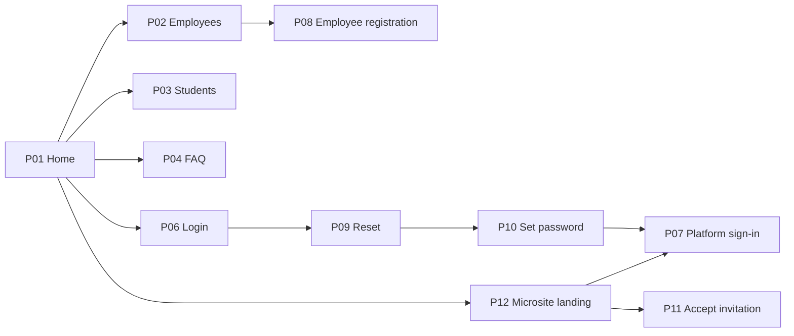
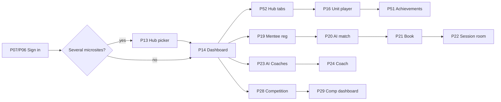
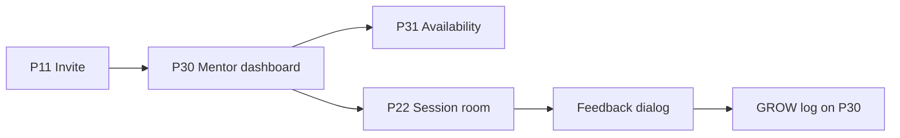
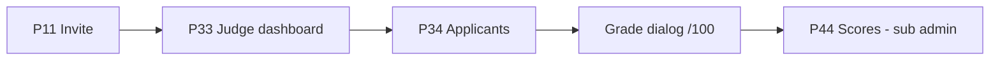
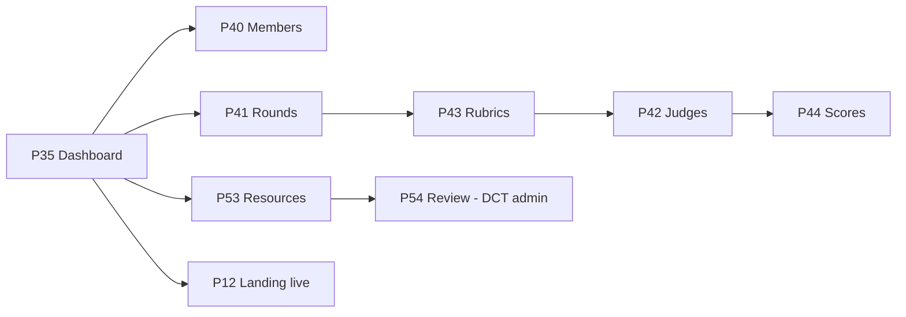
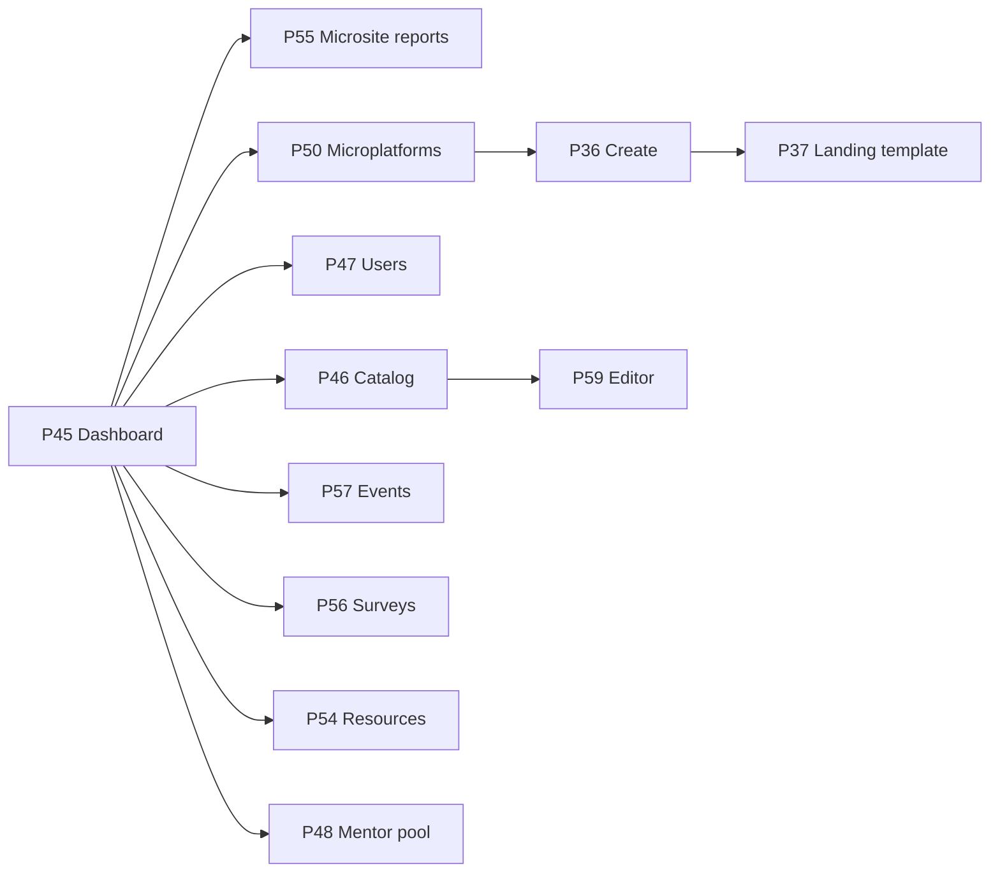

# DCT Learn user flows

High-level flow for each user type, with page codes and clean URLs (`{p}` is a microsite id such as `elevate`, `zu`, `nibras`).

## 1. Visitor (signed out)

Purpose: discover DCT Learn and its microsites, then sign in or register.
Entry: `/` → P01 Main home, or a microsite landing `/{p}/` → P12.

1. P01 Main home (`/`): hero, affiliate cards (microsites, VX Academy, Abu Dhabi Tourist Guide in a new tab).
2. P02 Employee home (`/professionals`), P03 Students home (`/students`), P04 FAQ (`/faq`).
3. P12 Platform landing (`/{p}/`): branded landing per microsite.
4. P06 Login / Register (`/login`), or P07 Platform sign-in (`/{p}/sign-in`) from a microsite.
5. P08 Employee registration (`/employee-registration`) for DCT employees.
6. P11 Accept invitation (`/{p}/invite`) for invite-only microsites.
7. Account access: P09 Reset password (`/reset-password`) → P10 Set password (`/set-password`) → sign in.
8. Unknown URLs or platform ids → P05 Page not found (`/404.html`).

## 2. Learner

Purpose: learn in one or more microsites: courses, certificates, mentoring, AI tools, competitions.
Entry: P06 (`/login`) → P13 if in several microsites, else P14. From a microsite's P07 (`/{p}/sign-in`) → that microsite's P14. Open microsites allow sign-up on P07; invite-only ones need P11.

1. P13 Choose your learning hub (`/platforms`): one card per microsite, each enters its P14 without a second sign-in.
2. P14 Dynamic dashboard (`/{p}/dashboard`): welcome, continue learning, mentoring, competition and resources cards, events, surveys, tour.
3. P52 Hub (`/{p}/hub/{tab}`): one sidebar page per tab set on P50 (Courses, Workshops, Mentors, AI Coaches, AI Tools, Additional resources).
4. P16 Unit player (`/{p}/learn`): course detail, lessons in order, Mark complete.
5. P51 Achievements (`/{p}/achievements`): points, badges, certificates, leaderboard. P15 Profile (`/{p}/profile`).
6. Mentoring (Elevate model): P17 Mentors (`/mentoring`) / P18 Mentor profile (`/mentoring/mentor`) → P19 Mentee registration (`/mentoring/register`) → P20 AI mentor match (`/mentoring/match`, learner chooses, allocated at once) → P21 Book a session (`/mentoring/book`) → P22 Session room (`/mentoring/session`) → feedback dialog.
7. AI tools: P23 AI Coaches (`/ai`) → P24 AI Coach (`/ai/coach`); P25 AI Tool (`/ai/tool`), P26 AI Lesson Planner (`/ai/lesson-planner`), P27 Voice Hiring (`/ai/voice-hiring`).
8. Competition (when on): P28 Competition (`/{p}/competition`) → P16 competition units (submission) → P29 Competition dashboard (`/{p}/competition/dashboard`).
9. Switch microsite: sidebar switcher → P13.

## 3. Mentor

Purpose: mentor learners from the shared mentor pool across microsites.
Entry: invited by the DCT Learn admin (P48) → P11 Accept invitation, then P06 (`/login`) → P30.

1. P11 Accept invitation (`/{p}/invite`) and set a password.
2. P30 Mentor dashboard (`/mentor`): mentees who chose them, upcoming and past sessions, applications.
3. P31 Availability (`/mentor/availability`): calendar and 1-hour slots learners can book.
4. P22 Session room (`/mentoring/session`): lobby, camera check, meeting.
5. Feedback dialog after the session (rating, no-show or absent).
6. P30: write the GROW log (Goal, Reality, Options, Way forward) per mentee.

## 4. Judge

Purpose: score competition applicants against a round's rubric.
Entry: invited by a sub admin (P42) → P11 Accept invitation, then P06 (`/login`) → P33.

1. P11 Accept invitation (`/{p}/invite`).
2. P33 Judge dashboard (`/judge`): assigned, graded, pending.
3. P34 Applicants and grading (`/judge/applicants`): filter by round, open an applicant.
4. Grade dialog: weighted criteria, 1–10 sliders, feedback, live weighted score out of 100.
5. Submit; the sub admin reviews results on P44.

## 5. Sub admin (microsite admin)

Purpose: run one existing microsite: landing look and settings, members, judging, resources.
Entry: P06 (`/login`) or P07 (`/{p}/sign-in`) → P35 Dashboard (`/{p}/admin`).

1. P35 Dashboard (`/{p}/admin`): status, KPIs, landing settings (popup, partner logos, social links, embedded form), Publish.
2. P40 Members and invites (`/{p}/admin/members`): invite by email or CSV, resend or revoke.
3. P41 Rounds (`/{p}/admin/rounds`): competition rounds, one active.
4. P43 Rubrics (`/{p}/admin/rubrics`): weighted criteria per round.
5. P42 Judges (`/{p}/admin/judges`): invite judges, assign applicants by round.
6. P44 Scores (`/{p}/admin/scores`): scores by judge with criterion breakdown.
7. P53 Additional resources (`/{p}/admin/resources`): add https links, submit for DCT Learn review; rejected ones show the note to fix and resubmit.

## 6. DCT Learn admin

Purpose: run DCT Learn: create and configure microsites, catalog, users, mentors, reports.
Entry: P06 (`/login`) → P45 Dashboard (`/admin`).

1. P45 Dashboard (`/admin`): general tab plus one tab per microsite; AI insights chat (`/admin#ai-insights`).
2. P55 DCT Learn Microsites (`/admin/microsites`): report per microsite.
3. P50 Microplatforms (`/admin/platforms`): current and requested microsites; Edit microsite sheet sets courses, learner tabs and sign-in mode.
4. P36 Create microplatform (`/admin/platforms/new`): pick a microsite template, branding, sub admin → P37 Landing templates (`/admin/templates`).
5. P47 Users and roles (`/admin/users`): one role per account.
6. P46 Course catalog (`/admin/catalog`) → P59 Course editor (`/admin/catalog/editor`).
7. P57 Events and workshops (`/admin/events`), P56 Surveys and applications (`/admin/surveys`).
8. P54 Resource verification (`/admin/resources`): approve, or reject with a note.
9. P48 Mentor pool (`/admin/mentors`): invite mentors, see mentee counts.

## Landing-only microsites (Ruwaad, CSMD)

`landingOnly: true`: no members, tabs or courses. Only P12 (`/ruwaad/`, `/csmd/`) exists; every other scoped route redirects to it. Ruwaad shows a register-interest form.
